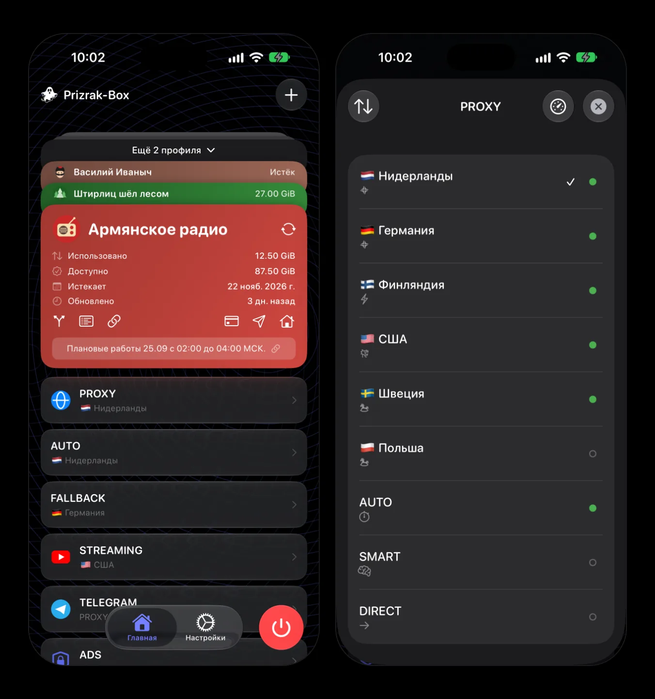

# Prizrak-Box

A cross-platform proxy client built on the Mihomo (Clash.Meta) core

[Download](https://github.com/legiz-ru/Prizrak-Box/releases/latest) · [Documentation](https://docs.prizrak.app) · [Telegram](https://t.me/legiz_trashbag) · [Русский](#русский)

## Features

- **Subscriptions** — remote Clash YAML subscriptions with auto-update, local configs, and proxy keys (`vless://`, `hy2://` and more) with built-in templates.
- **Routing** — built-in rule templates for Russia and China, geo-IP and domain lists, your own routing on top of a subscription.
- **TUN mode** — all device traffic through the proxy, without per-app setup.
- **Connections** — live list, topology, and per-process traffic.
- **AGE-encrypted subscriptions**, one-click setup from a provider's portal (deep links), [Remnawave](https://docs.prizrak.app/for-devs/remnawave-integration/) integration.
- **Prizrak-Core** — a Mihomo fork with XHTTP, extra uTLS fingerprints and more: [core.prizrak.app](https://core.prizrak.app).

## Download

All builds are in [Releases](https://github.com/legiz-ru/Prizrak-Box/releases/latest) ([including pre-releases](https://github.com/legiz-ru/Prizrak-Box/releases)).

| Platform | Files |
|---|---|
| Windows 10/11 | `windows-amd64.msi` · `windows-arm64.msi` — installer; `.zip` — portable |
| macOS 12+ | `macos-arm64.dmg` (Apple Silicon) · `macos-amd64.dmg` (Intel) |
| Linux | `linux-amd64.deb` / `.rpm` / `-aur.tar.zst` (Arch), same for `arm64`; AUR: `prizrak-box-bin` |
| Android, Android TV | `prizrak-box-android-universal.apk` or the APK for your ABI; [Obtainium](https://docs.prizrak.app/install/) for auto-updates |
| iOS, iPadOS, tvOS | testing in TestFlight |

Step-by-step instructions: [docs.prizrak.app/install](https://docs.prizrak.app/install/).

> **macOS:** if the app "is damaged" or "the developer cannot be verified", run
> `xattr -dr com.apple.quarantine /Applications/Prizrak-Box.app`

## Documentation

- [About the app](https://docs.prizrak.app/about/) · [FAQ](https://docs.prizrak.app/faq/) · [Android TV](https://docs.prizrak.app/android-tv/)
- For providers and developers: [supported headers](https://docs.prizrak.app/for-devs/supported-headers/), [deep links](https://docs.prizrak.app/for-devs/deep-linking/), [routing](https://docs.prizrak.app/for-devs/routing/), [AGE encryption](https://docs.prizrak.app/for-devs/age-encryption/), [Remnawave](https://docs.prizrak.app/for-devs/remnawave-integration/)

## Community

[Developer channel](https://t.me/legiz_trashbag) · [Community chat](https://t.me/+OqHkX0bo178xNDcy) · [Issues](https://github.com/legiz-ru/Prizrak-Box/issues)

---

## Русский

Кроссплатформенный прокси-клиент на ядре Mihomo (Clash.Meta): Windows, macOS, Linux, Android, Android TV; iOS, iPadOS и tvOS — в тестировании (TestFlight).

**Возможности:** подписки Clash YAML с автообновлением, локальные конфиги и прямые ключи (`vless://`, `hy2://` и другие) со встроенными шаблонами; шаблоны правил для России и Китая и своя маршрутизация поверх подписки; режим TUN; соединения — списком, топологией и по процессам; подписки с шифрованием AGE, настройка в один клик из кабинета провайдера, интеграция с Remnawave; ядро [Prizrak-Core](https://core.prizrak.app).

**Скачать:** [последний релиз](https://github.com/legiz-ru/Prizrak-Box/releases/latest) (файлы — в таблице выше). Пошагово: [docs.prizrak.app/ru/install](https://docs.prizrak.app/ru/install/).

**macOS:** если система пишет, что приложение повреждено или разработчик не проверен — `xattr -dr com.apple.quarantine /Applications/Prizrak-Box.app`

**Документация:** [docs.prizrak.app/ru](https://docs.prizrak.app/ru/) — о приложении, FAQ, Android TV, раздел для провайдеров и разработчиков (заголовки, deep links, маршрутизация, AGE, Remnawave).

**Сообщество:** [канал разработчика](https://t.me/legiz_trashbag) · [чат](https://t.me/+OqHkX0bo178xNDcy)
