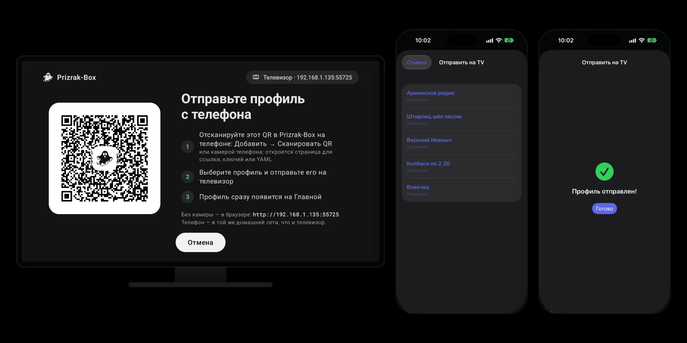

import { Steps, Aside } from '@astrojs/starlight/components';

Prizrak-Box runs on Android TV with the same functionality as the Android phone version, and on Apple TV.
Typing a long subscription link with a remote is no fun, so the TV takes the profile from your phone instead:
it shows a QR code, the phone sends the profile over your home network, and the TV adds it right away.

## Sending a Profile from Your Phone

<Steps>
1. Make sure the phone and the TV are on the **same home network**. The TV can be connected to the router by Wi-Fi or by cable.
2. On the TV, open Prizrak-Box and go to **Add Profile → From another device** (on Apple TV: **Receive from a device**).
   The TV shows a QR code.

   If the VPN is on on the TV, the screen first asks you to turn it off: while it is on, the phone cannot reach the TV over the home network.
   Press **Turn off VPN** — the QR code appears right away. You turn the new profile on from Home afterwards.
3. Scan the QR code with your phone, whichever way is handier:
   - **the phone's camera** — open the link it offers, paste a subscription link, keys or YAML and tap **Send to TV**;
   - **Prizrak-Box on the phone** — **Add → Scan QR Code**, then pick the profile: it goes over whole, with its keys and template;
   - **[pxtv](https://tv.prizrak.app)** — paste the link (or open pxtv from your subscription page), tap **Scan**, point it at the QR code and tap **Send to TV**.
4. The TV adds the profile at once and opens Home with it. The phone shows that the profile is on the TV.
</Steps>

<Aside type="tip">
The phone cannot open the TV's page? It needs the same home network as the TV: not a guest Wi-Fi and not mobile data.
If the phone has a VPN on, the local network must bypass it. After a minute without a phone, the TV shows the same hint.
</Aside>

<Aside type="note">
One QR code takes one profile: once a profile has arrived, the TV closes the import screen. To send another one, open the import on the TV again.
No camera at hand? The address for a browser is written on the TV screen under the steps.
</Aside>

## Apple TV

Prizrak-Box on Apple TV receives profiles the same way: the same QR code, the same page on the phone, the same apps and pxtv.

## Manual Import

If you prefer not to use the phone, you can also type the subscription URL directly on the TV using the on-screen keyboard, or use Android TV's built-in text sharing if your launcher supports it.
