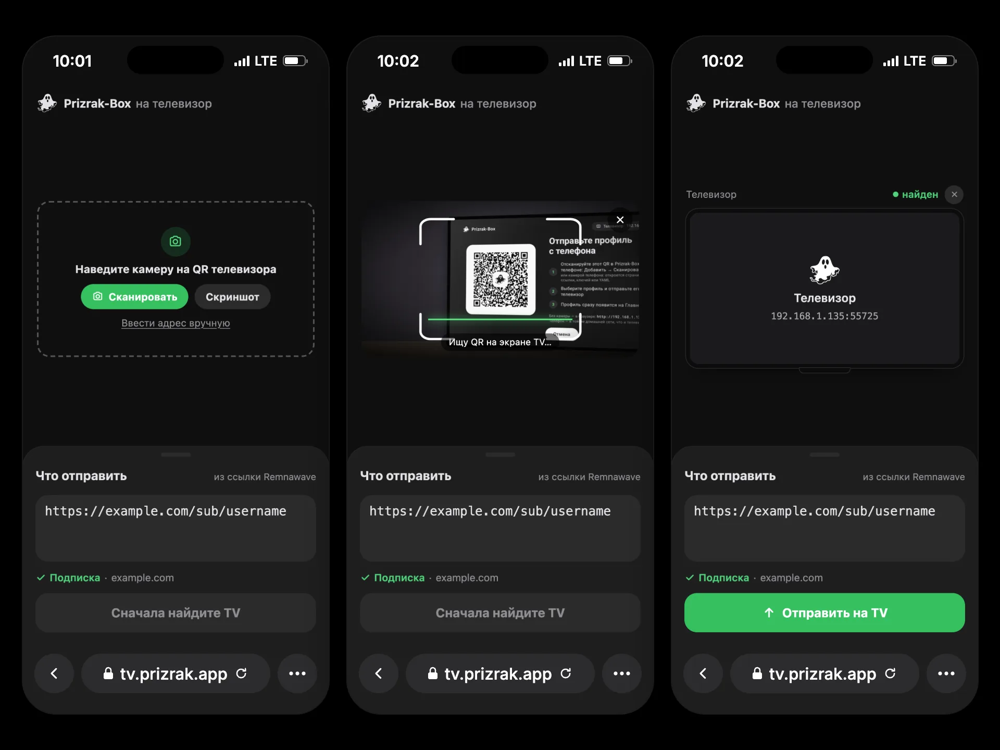

import { LinkCard, Aside } from '@astrojs/starlight/components';

## pxtv — Import from a Subscription Page



**[pxtv](https://github.com/legiz-ru/pxtv)** is a companion web page for Prizrak-Box on Android TV and Apple TV.

Its main purpose: **let users send a subscription from their provider's web page to the TV** — without typing long URLs with a remote.

The workflow:
1. The user opens the import screen on the TV (**Add Profile → From another device**; on Apple TV **Receive from a device**). The TV shows a QR code.
2. On the phone, they open pxtv from your subscription page — the link is already filled in.
3. They tap **Scan** and point the camera at the TV's QR code (a screenshot or the TV's address typed by hand also works).
4. **Send to TV** opens the TV's own page, which sends the profile. The TV adds it at once and opens Home.

The phone and the TV must be on the same home network (the TV on Wi-Fi or cable), and the VPN on the TV must be off — the TV asks for that itself.
pxtv only opens the TV's page: the profile goes from the phone straight to the TV and never passes through pxtv's server.

### Link Parameters

| Parameter | Meaning |
|---|---|
| `url` | The subscription link (or keys, or YAML), filled into the field. |
| `name` | The profile's name on the TV. Without it: the subscription's host, "My keys" or "My YAML". |
| `template` | The profile's template: a YAML template link `https://…`; a routing link `happ://…`, `incy://…` or `prizrak-box://…`; or a built-in `default`, `ru_bundle`, `subscription` (the subscription's own YAML as is). Not shown on the page. |

`name` and `template` reach only a TV with the new Prizrak-Box (a QR code with `v=2`). An older TV gets just the field's content.

### Remnawave

Remnawave subscription pages support links with `?url=`. Use:

```
https://tv.prizrak.app?url={{SUBSCRIPTION_LINK}}
```

With a name and a template (`url` last):

```
https://tv.prizrak.app?name=MyVPN&template=https://example.com/templates/smart.yaml&url={{SUBSCRIPTION_LINK}}
```

pxtv also accepts an unencoded subscription link, even with `&` inside; only what follows `#` is lost.
To host pxtv yourself, take the single file `docs/index.html` and serve it over HTTPS (the camera needs it).

<LinkCard
  title="pxtv on GitHub"
  description="Web page for sending a subscription, keys or YAML to Prizrak-Box on Android TV and Apple TV."
  href="https://github.com/legiz-ru/pxtv"
/>

## PXT v2 — the Transfer

For those building their own sender. Prizrak-Box apps on phones and pxtv use the same protocol.

### The QR code

```
http://<ip>:<port>/Prizrak-BoxTVimport?v=2&t=<token>&k=<key>
```

- `t` — 16 random bytes, base64url without padding: a one-time token.
- `k` — 32 random bytes, base64url without padding: the AES-256 key. It exists only in the QR code.
- Older TVs put `v=1`, or no `v` at all. Recognise a TV's QR code by its path, `/Prizrak-BoxTVimport`.

The address is the TV's Wi-Fi or Ethernet one, never a VPN interface.

### Endpoints

| Request | What it does |
|---|---|
| `GET /Prizrak-BoxTVimport` | The TV's own web page. |
| `GET /Prizrak-BoxTVimport/api/ping` | `200 {"status":"ok","pxt":2,"app":"…"}`. Older TVs answer without `pxt`. |
| `POST /Prizrak-BoxTVimport/api/transfer` | The encrypted transfer, below. |
| `POST /Prizrak-BoxTVimport/submit` | Plain `{"content":"…"}`: a link, keys or YAML as text, for a sender without `t`/`k`. Never v2. |

The TV takes one profile: after the first accepted transfer it stops listening.

### `/api/transfer`

- Header `X-PXA-Token: <t>`.
- Body `{"nonce":"…","data":"…"}`: a 12-byte nonce and the ciphertext with its 16-byte GCM tag, both base64url. AES-256-GCM with the key `k`, no associated data.
- The plaintext is UTF-8 JSON, v1 or v2, at most 4 MB.
- The answer comes as soon as the profile is decrypted and checked, before it is imported; wait up to 5 s:
  - 200 `{"status":"ok"}`;
  - 403 `Invalid token` or `Already used`;
  - 400 `Decryption failed`, `Missing type` or `Bad payload`;
  - 413 `Too large`.

### Payload v1

Accepted by every TV, old and new:

```json
{"type":"url","url":"https://sub.example.net/api/sub/abc123","name":"Home","age-secret-key":"AGE-SECRET-KEY-…"}
{"type":"yaml","content":"<yaml>","name":"Home"}
{"type":"text","content":"<a link, keys or YAML>"}
```

`name` and `age-secret-key` are optional.

### Payload v2

The whole profile — keys, template, age key, update interval:

```json
{
  "pxt": 2,
  "from": "MyApp 1.0",
  "profile": {
    "name": "Home",
    "keys": [
      {"kind": "subscription", "value": "https://sub.example.net/api/sub/abc123"},
      {"kind": "links", "value": "vless://…@example.net:443?…#NL\ntrojan://…@example.org:443#DE", "name": "My keys"}
    ],
    "template": "#t1",
    "update-hours": 24
  },
  "templates": [
    {"ref": "t1", "kind": "template", "name": "Smart", "url": "https://example.com/templates/smart.yaml", "update-hours": 24}
  ]
}
```

- `pxt` — 2. A plaintext with `pxt` ≥ 2 is v2; without `pxt` it is v1.
- `profile.name` — required.
- `profile.keys` **or** `profile.yaml` — exactly one, not empty:
  - `keys` — the profile's keys in order; `kind` is `subscription` (a URL), `links` (proxy links, one a line), `config` (a WireGuard `.conf`) or `amnezia` (a `vpn://` key); `name` is optional;
  - `yaml` — a YAML profile of one's own.
- `profile.template` — optional: `default` or `ru_bundle` (built-in), `subscription` (the subscription's own YAML as is), or `#<ref>` (an entry of `templates`). Absent or unknown: the TV's usual choice.
- `profile.age-secret-key`, `profile.update-hours` — optional.
- `templates` — optional entries, each with a unique `ref`:
  - `kind: "template"` — `name`, then `yaml` (the content) and/or `url` (where it updates from), `update-hours`;
  - `kind: "routing"` — a Happ / INCY routing: `name`, then `json`, `url` (autorouting) and/or `link` (`happ://…`, `incy://…`, `prizrak-box://…`), `update-hours`.

  The TV reuses a template it already has (same URL or content), otherwise adds it. An entry it cannot get is skipped.

The TV imports the profile at once: one subscription key becomes a normal subscription, several keys a converted profile, `yaml` a file profile. A name already taken gets « (2)». The profile becomes active and Home opens.

### v1 or v2

Send v2 only when the QR code has `v` ≥ 2 or `/api/ping` answers `pxt` ≥ 2. Otherwise send v1: to `/api/transfer` with `t`/`k`, to `/submit` without them. An older TV answers a v2 profile with 400 `Missing type`.

### From a web page

A page served over HTTPS cannot call the TV's plain-HTTP address (mixed content). Open the TV's own page instead, as pxtv does — it encrypts and sends by itself:

| QR code | Open |
|---|---|
| `v` ≥ 2 | `…/Prizrak-BoxTVimport?v=2&t=…&k=…&autosubmit=true#pxt=<base64url of the v2 JSON>` |
| `v=1` or no `v`, with `t`/`k` | `…/Prizrak-BoxTVimport?v=1&t=…&k=…&autosubmit=true&url=<text>` |
| no `t`/`k` | `…/Prizrak-BoxTVimport?url=<text>` — the field is filled, the user taps Send |

The part after `#` never leaves the phone.

### Compatibility

| Sender | Older TV | New TV |
|---|---|---|
| Older app, older pxtv | v1, as before | v1 — accepted forever |
| New app | v1; the app warns that the template and extra keys will not carry over | v2, the whole profile |
| New pxtv | v1; pxtv suggests updating Prizrak-Box on the TV | v2 |
| Browser, address typed by hand | `/submit` | `/submit` |

<Aside type="note">
Apple TV and Android TV speak the same protocol and serve the same web page.
</Aside>
