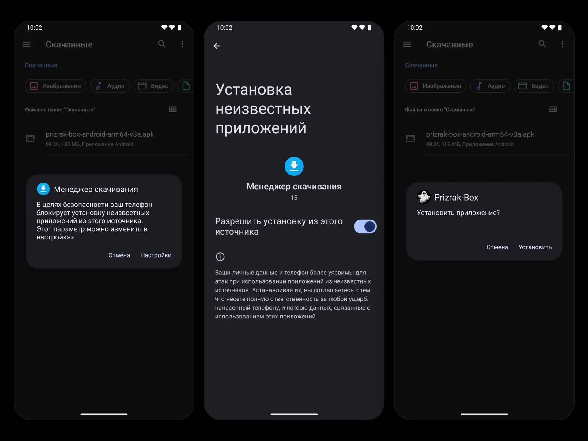

import { Tabs, TabItem, Steps } from '@astrojs/starlight/components';

All releases are available on GitHub: [latest stable](https://github.com/legiz-ru/Prizrak-Box/releases/latest) · [all releases including pre-releases](https://github.com/legiz-ru/Prizrak-Box/releases).

On Windows, macOS and Linux, choose the file for your system and architecture (e.g. `windows-amd64.msi`, `macos-arm64.dmg`, `linux-amd64.deb`).

<Tabs>
  <TabItem label="Android">

## Android

### Via Obtainium (Recommended)

[Obtainium](https://github.com/ImranR98/Obtainium) lets you install and auto-update Prizrak-Box directly from GitHub Releases.

<Steps>
1. Install [Obtainium](https://github.com/ImranR98/Obtainium/releases/latest).
2. Open the <a href="https://legiz-ru.github.io/Orion/redirect-page/?redirect_to=obtainium://app/%7B%22id%22:%22ru.legiz.prizrakbox.meta%22,%22url%22:%22https://github.com/legiz-ru/Prizrak-Box/releases%22,%22author%22:%22legiz-ru%22,%22name%22:%22Prizrak-Box%22,%22preferredApkIndex%22:0,%22additionalSettings%22:%22%7B%5C%22includePrereleases%5C%22:true,%5C%22fallbackToOlderReleases%5C%22:true,%5C%22autoApkFilterByArch%5C%22:true,%5C%22trackOnly%5C%22:false,%5C%22versionDetection%5C%22:true%7D%22%7D">Obtainium link for Prizrak-Box</a> — it will pre-fill all settings automatically.
3. Tap **Add** and then **Install**.
</Steps>

### Manual APK

<Steps>
1. Go to the [latest stable release](https://github.com/legiz-ru/Prizrak-Box/releases/latest) or [all releases (including pre-releases)](https://github.com/legiz-ru/Prizrak-Box/releases).
2. Download the APK matching your device architecture:
   - `universal` — works on all devices
   - `arm64-v8a` — 64-bit ARM (most modern phones)
   - `armeabi-v7a` — 32-bit ARM (older devices)
   - `x86_64` — 64-bit x86 (emulators)
3. Enable **Install from unknown sources** in your device settings.
4. Open the downloaded APK to install.
</Steps>

:::note
The APK includes a built-in update checker — it will notify you when a new release is available directly from GitHub.
:::



  </TabItem>
  <TabItem label="Windows">

## Windows

<Steps>
1. Go to the [latest stable release](https://github.com/legiz-ru/Prizrak-Box/releases/latest) or [all releases (including pre-releases)](https://github.com/legiz-ru/Prizrak-Box/releases).
2. Download the `.msi` installer for your PC:
   - `windows-amd64.msi` — x64 (most PCs), the **Setup x64** download button
   - `windows-arm64.msi` — ARM (e.g. Snapdragon), the **Setup arm** button

   A portable build without installation is also available: `windows-amd64.zip` / `windows-arm64.zip`.
3. Run the installer — administrator confirmation will be required. The installer also sets up the service that TUN mode uses, and upgrades an installed older version in place.
4. Launch **Prizrak-Box** from the Start menu or desktop shortcut.
5. Adding a provider configuration: click **Add** in the profiles menu and enter your subscription URL. One-click automatic configuration from your provider's portal is also supported.
</Steps>


:::note
Windows Defender may show a SmartScreen warning on first launch. Click **More info** → **Run anyway**.
:::

  </TabItem>
  <TabItem label="macOS">

## macOS

<Steps>
1. Go to the [latest stable release](https://github.com/legiz-ru/Prizrak-Box/releases/latest) or [all releases (including pre-releases)](https://github.com/legiz-ru/Prizrak-Box/releases).
2. Download the `.dmg` file for your Mac (macOS 12 Monterey or later):
   - `macos-arm64.dmg` — Apple Silicon
   - `macos-amd64.dmg` — Intel
3. Open the `.dmg` and drag **Prizrak-Box** to your Applications folder. If asked whether to replace an existing copy, click **Replace** — settings and profiles are kept.
4. On first launch macOS will ask you to confirm opening — click **Open**.
5. Adding a provider configuration: click **Add** in the profiles menu and enter your subscription URL. One-click automatic configuration from your provider's portal is also supported.
</Steps>


:::caution
If macOS says that **Prizrak-Box is damaged** or that **the developer cannot be verified** (builds that are not signed with a Developer ID), run in Terminal:
```bash
xattr -dr com.apple.quarantine /Applications/Prizrak-Box.app
```
:::

:::note
TUN mode needs the Prizrak-Box service: install it in **Settings → Application → Service Mode → Install Service** and confirm with your administrator password.
:::

  </TabItem>
  <TabItem label="Linux">

## Linux

<Steps>
1. Go to the [latest stable release](https://github.com/legiz-ru/Prizrak-Box/releases/latest) or [all releases (including pre-releases)](https://github.com/legiz-ru/Prizrak-Box/releases).
2. Download the package for your architecture and distribution:
   - amd64 (x86_64): `linux-amd64.deb`, `linux-amd64.rpm` or `linux-amd64-aur.tar.zst` (Arch)
   - arm64: `linux-arm64.deb`, `linux-arm64.rpm` or `linux-arm64-aur.tar.zst` (Arch)
3. Install the downloaded package from the folder you saved it to — the package manager pulls in the dependencies:
   - For `.deb` (Debian/Ubuntu and derivatives):
     ```bash
     sudo apt install ./linux-amd64.deb
     ```
   - For `.rpm` (Fedora and derivatives):
     ```bash
     sudo dnf install ./linux-amd64.rpm
     ```
     On openSUSE use `sudo zypper install ./linux-amd64.rpm`.
   - For Arch Linux and derivatives:
     ```bash
     sudo pacman -U ./linux-amd64-aur.tar.zst
     ```

   The package also installs and starts the service that TUN mode uses.
4. Launch **Prizrak-Box** from your application list.
5. Adding a provider configuration: click **Add** in the profiles menu and enter your subscription URL. One-click automatic configuration from your provider's portal is also supported.
</Steps>

:::note[AUR]
Arch Linux users can also install from the AUR:
```bash
yay -S prizrak-box-bin
```
:::

  </TabItem>
  <TabItem label="iOS">

## iOS

The iOS version is in testing. The TestFlight link for testing is available in the [developer's Telegram channel](https://t.me/legiz_trashbag). An App Store release will follow.

  </TabItem>
</Tabs>
