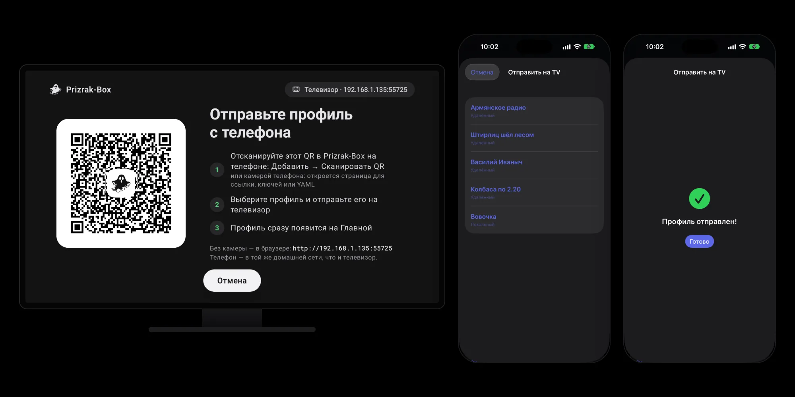

import { Steps, Aside } from '@astrojs/starlight/components';

Prizrak-Box работает на Android TV с теми же возможностями, что и мобильная версия для Android, а также на Apple TV.
Набирать длинную ссылку на подписку пультом неудобно, поэтому телевизор принимает профиль с телефона:
на экране — QR-код, телефон отправляет профиль по домашней сети, телевизор сразу его добавляет.

## Отправка профиля с телефона

<Steps>
1. Убедитесь, что телефон и телевизор в **одной домашней сети**. Телевизор может быть подключён к роутеру по Wi-Fi или кабелем.
2. На телевизоре откройте Prizrak-Box: **Добавить профиль → С другого устройства** (на Apple TV — **Принять с устройства**).
   На экране появится QR-код.

   Если на телевизоре включён VPN, экран сначала попросит его выключить: пока VPN включён, телефон не дотянется до телевизора по домашней сети.
   Нажмите **Выключить VPN** — QR-код появится сразу. Новый профиль потом включается на Главной.
3. Отсканируйте QR-код телефоном — как удобнее:
   - **камерой телефона** — откройте предложенную ссылку, вставьте ссылку на подписку, ключи или YAML и нажмите **Отправить на TV**;
   - **в Prizrak-Box на телефоне** — **Добавить → Сканировать QR-код** и выберите профиль: он уйдёт целиком, с ключами и шаблоном;
   - **в [pxtv](https://tv.prizrak.app)** — вставьте ссылку (или откройте pxtv со страницы подписки), нажмите **Сканировать**, наведите на QR-код и нажмите **Отправить на TV**.
4. Телевизор сразу добавит профиль и откроет Главную с ним. На телефоне — «Профиль на телевизоре».
</Steps>

<Aside type="tip">
Телефон не открывает страницу телевизора? Нужна та же домашняя сеть: не гостевая Wi-Fi и не мобильный интернет.
Если на телефоне включён VPN, локальная сеть должна идти мимо него. Через минуту без телефона телевизор сам покажет эту подсказку.
</Aside>

<Aside type="note">
Один QR-код — один профиль: получив профиль, телевизор закрывает импорт. Чтобы отправить ещё один, снова откройте импорт на телевизоре.
Нет камеры под рукой? Адрес для браузера написан на экране телевизора под шагами.
</Aside>

## Apple TV

Prizrak-Box на Apple TV принимает профили так же: тот же QR-код, та же страница на телефоне, те же приложения и pxtv.

## Ручной импорт

Если не хотите пользоваться телефоном, можно также ввести URL подписки вручную через экранную клавиатуру телевизора.
