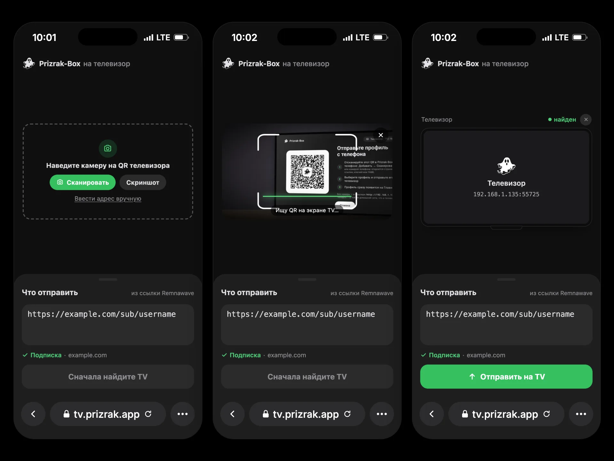

import { LinkCard, Aside } from '@astrojs/starlight/components';

## pxtv — импорт со страницы подписки



**[pxtv](https://github.com/legiz-ru/pxtv)** — вспомогательная веб-страница для Prizrak-Box на Android TV и Apple TV.

Главная задача: **дать пользователям отправить подписку со страницы провайдера прямо на телевизор** — без ввода длинных URL пультом.

Принцип работы:
1. Пользователь открывает импорт на телевизоре (**Добавить профиль → С другого устройства**, на Apple TV — **Принять с устройства**). На экране — QR-код.
2. На телефоне он открывает pxtv с вашей страницы подписки — ссылка уже в поле.
3. Нажимает **Сканировать** и наводит камеру на QR телевизора (подойдёт и скриншот, и адрес телевизора, введённый вручную).
4. **Отправить на TV** открывает страницу самого телевизора, и она отправляет профиль. Телевизор сразу его добавляет и открывает Главную.

Телефон и телевизор должны быть в одной домашней сети (телевизор — по Wi-Fi или кабелем), а VPN на телевизоре — выключен: телевизор сам об этом попросит.
pxtv только открывает страницу телевизора: профиль уходит с телефона прямо на телевизор и через сервер pxtv не проходит.

### Параметры ссылки

| Параметр | Что делает |
|---|---|
| `url` | Ссылка на подписку (или ключи, YAML) — сразу в поле. |
| `name` | Имя профиля на телевизоре. Без него — домен подписки, «Мои ключи» или «Мой YAML». |
| `template` | Шаблон профиля: ссылка на YAML-шаблон `https://…`; ссылка на роутинг `happ://…`, `incy://…` или `prizrak-box://…`; либо встроенный `default`, `ru_bundle`, `subscription` (собственный YAML подписки как есть). На странице не показывается. |

`name` и `template` доходят только до телевизора с новым Prizrak-Box (QR с `v=2`). Старый телевизор получит лишь содержимое поля.

### Remnawave

Страницы подписки Remnawave поддерживают ссылки с `?url=`. Используйте:

```
https://tv.prizrak.app?url={{SUBSCRIPTION_LINK}}
```

С именем и шаблоном (`url` — последним):

```
https://tv.prizrak.app?name=MyVPN&template=https://example.com/templates/smart.yaml&url={{SUBSCRIPTION_LINK}}
```

pxtv понимает и незакодированную ссылку подписки, даже с `&` внутри; теряется только то, что после `#`.
Чтобы разместить pxtv у себя, возьмите единственный файл `docs/index.html` и отдавайте его по HTTPS (иначе не работает камера).

<LinkCard
  title="pxtv на GitHub"
  description="Веб-страница для отправки подписки, ключей или YAML в Prizrak-Box на Android TV и Apple TV."
  href="https://github.com/legiz-ru/pxtv"
/>

## PXT v2 — передача профиля

Для тех, кто делает свой отправитель. Этим же протоколом пользуются приложения Prizrak-Box на телефонах и pxtv.

### QR-код

```
http://<ip>:<port>/Prizrak-BoxTVimport?v=2&t=<token>&k=<key>
```

- `t` — 16 случайных байт, base64url без `=`: одноразовый токен.
- `k` — 32 случайных байта, base64url без `=`: ключ AES-256. Он есть только в QR-коде.
- Старые телевизоры ставят `v=1` или не ставят `v` совсем. QR телевизора узнаётся по пути `/Prizrak-BoxTVimport`.

Адрес — Wi-Fi или Ethernet телевизора, никогда не VPN-интерфейс.

### Адреса

| Запрос | Что делает |
|---|---|
| `GET /Prizrak-BoxTVimport` | Страница самого телевизора. |
| `GET /Prizrak-BoxTVimport/api/ping` | `200 {"status":"ok","pxt":2,"app":"…"}`. Старые телевизоры отвечают без `pxt`. |
| `POST /Prizrak-BoxTVimport/api/transfer` | Зашифрованная передача, ниже. |
| `POST /Prizrak-BoxTVimport/submit` | Открытый `{"content":"…"}`: ссылка, ключи или YAML текстом, для отправителя без `t`/`k`. Никогда не v2. |

Телевизор принимает один профиль: после первой принятой передачи он перестаёт слушать.

### `/api/transfer`

- Заголовок `X-PXA-Token: <t>`.
- Тело `{"nonce":"…","data":"…"}`: nonce 12 байт и шифротекст с 16-байтным тегом GCM, оба в base64url. AES-256-GCM с ключом `k`, без дополнительных данных (AAD).
- Открытый текст — JSON в UTF-8, v1 или v2, не больше 4 МБ.
- Ответ приходит сразу после расшифровки и проверки, до импорта; ждите до 5 с:
  - 200 `{"status":"ok"}`;
  - 403 `Invalid token` или `Already used`;
  - 400 `Decryption failed`, `Missing type` или `Bad payload`;
  - 413 `Too large`.

### Формат v1

Принимают все телевизоры, старые и новые:

```json
{"type":"url","url":"https://sub.example.net/api/sub/abc123","name":"Дом","age-secret-key":"AGE-SECRET-KEY-…"}
{"type":"yaml","content":"<yaml>","name":"Дом"}
{"type":"text","content":"<ссылка, ключи или YAML>"}
```

`name` и `age-secret-key` необязательны.

### Формат v2

Профиль целиком — ключи, шаблон, age-ключ, интервал обновления:

```json
{
  "pxt": 2,
  "from": "MyApp 1.0",
  "profile": {
    "name": "Дом",
    "keys": [
      {"kind": "subscription", "value": "https://sub.example.net/api/sub/abc123"},
      {"kind": "links", "value": "vless://…@example.net:443?…#NL\ntrojan://…@example.org:443#DE", "name": "Мои ключи"}
    ],
    "template": "#t1",
    "update-hours": 24
  },
  "templates": [
    {"ref": "t1", "kind": "template", "name": "Smart", "url": "https://example.com/templates/smart.yaml", "update-hours": 24}
  ]
}
```

- `pxt` — 2. Открытый текст с `pxt` ≥ 2 — это v2, без `pxt` — v1.
- `profile.name` — обязательно.
- `profile.keys` **или** `profile.yaml` — ровно одно из двух, не пустое:
  - `keys` — ключи профиля по порядку; `kind` — `subscription` (URL), `links` (прокси-ссылки, по одной в строке), `config` (WireGuard `.conf`) или `amnezia` (ключ `vpn://`); `name` необязательно;
  - `yaml` — собственный YAML-профиль.
- `profile.template` — необязательно: `default` или `ru_bundle` (встроенные), `subscription` (собственный YAML подписки как есть) или `#<ref>` (запись из `templates`). Нет или неизвестно — обычный выбор телевизора.
- `profile.age-secret-key`, `profile.update-hours` — необязательны.
- `templates` — необязательные записи, у каждой свой `ref`:
  - `kind: "template"` — `name`, затем `yaml` (содержимое) и/или `url` (откуда обновлять), `update-hours`;
  - `kind: "routing"` — роутинг Happ / INCY: `name`, затем `json`, `url` (авто-роутинг) и/или `link` (`happ://…`, `incy://…`, `prizrak-box://…`), `update-hours`.

  Телевизор берёт уже имеющийся шаблон (тот же URL или содержимое), иначе добавляет новый. Запись, которую не удалось получить, пропускается.

Телевизор импортирует профиль сразу: один ключ-подписка — обычная подписка, несколько ключей — сконвертированный профиль, `yaml` — профиль-файл. К занятому имени добавляется « (2)». Профиль становится активным, открывается Главная.

### v1 или v2

Отправляйте v2, только если в QR `v` ≥ 2 или `/api/ping` отвечает `pxt` ≥ 2. Иначе — v1: в `/api/transfer` с `t`/`k`, в `/submit` без них. Старый телевизор отвечает на v2 ошибкой 400 `Missing type`.

### С веб-страницы

Страница на HTTPS не может обратиться к телевизору по HTTP (mixed content). Вместо этого откройте страницу самого телевизора, как делает pxtv, — она сама зашифрует и отправит:

| QR-код | Что открыть |
|---|---|
| `v` ≥ 2 | `…/Prizrak-BoxTVimport?v=2&t=…&k=…&autosubmit=true#pxt=<base64url JSON v2>` |
| `v=1` или без `v`, с `t`/`k` | `…/Prizrak-BoxTVimport?v=1&t=…&k=…&autosubmit=true&url=<текст>` |
| без `t`/`k` | `…/Prizrak-BoxTVimport?url=<текст>` — поле заполнено, отправляет пользователь |

Часть адреса после `#` не уходит с телефона.

### Совместимость

| Отправитель | Старый телевизор | Новый телевизор |
|---|---|---|
| Старое приложение, старый pxtv | v1, как раньше | v1 — принимается всегда |
| Новое приложение | v1; приложение предупредит, что шаблон и дополнительные ключи не перенесутся | v2, профиль целиком |
| Новый pxtv | v1; pxtv советует обновить Prizrak-Box на телевизоре | v2 |
| Браузер, адрес введён вручную | `/submit` | `/submit` |

<Aside type="note">
Apple TV и Android TV говорят на одном протоколе и отдают одну и ту же страницу.
</Aside>
