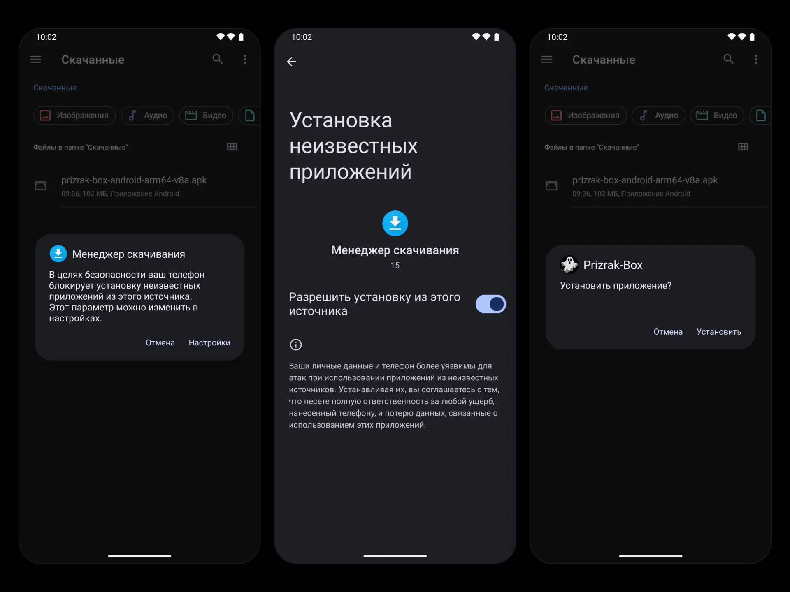

import { Tabs, TabItem, Steps } from '@astrojs/starlight/components';

Все релизы доступны на GitHub: [последний стабильный](https://github.com/legiz-ru/Prizrak-Box/releases/latest) · [все релизы включая пре-релизы](https://github.com/legiz-ru/Prizrak-Box/releases).

Для Windows, macOS и Linux выберите файл под свою систему и архитектуру (например, `windows-amd64.msi`, `macos-arm64.dmg`, `linux-amd64.deb`).

<Tabs>
  <TabItem label="Android">

## Android

### Через Obtainium (рекомендуется)

[Obtainium](https://github.com/ImranR98/Obtainium) позволяет устанавливать и автоматически обновлять Prizrak-Box прямо из GitHub Releases.

<Steps>
1. Установите [Obtainium](https://github.com/ImranR98/Obtainium/releases/latest).
2. Откройте <a href="https://legiz-ru.github.io/Orion/redirect-page/?redirect_to=obtainium://app/%7B%22id%22:%22ru.legiz.prizrakbox.meta%22,%22url%22:%22https://github.com/legiz-ru/Prizrak-Box/releases%22,%22author%22:%22legiz-ru%22,%22name%22:%22Prizrak-Box%22,%22preferredApkIndex%22:0,%22additionalSettings%22:%22%7B%5C%22includePrereleases%5C%22:true,%5C%22fallbackToOlderReleases%5C%22:true,%5C%22autoApkFilterByArch%5C%22:true,%5C%22trackOnly%5C%22:false,%5C%22versionDetection%5C%22:true%7D%22%7D">ссылку Obtainium для Prizrak-Box</a> — все настройки заполнятся автоматически.
3. Нажмите **Добавить**, затем **Установить**.
</Steps>

### Ручная установка APK

<Steps>
1. Перейдите на страницу [последнего стабильного релиза](https://github.com/legiz-ru/Prizrak-Box/releases/latest) или [всех релизов (включая пре-релизы)](https://github.com/legiz-ru/Prizrak-Box/releases).
2. Скачайте APK для вашей архитектуры:
   - `universal` — подходит для всех устройств
   - `arm64-v8a` — 64-битный ARM (большинство современных телефонов)
   - `armeabi-v7a` — 32-битный ARM (старые устройства)
   - `x86_64` — 64-битный x86 (эмуляторы)
3. В настройках устройства разрешите установку из неизвестных источников.
4. Откройте скачанный APK для установки.
</Steps>

:::note
APK содержит встроенную проверку обновлений — приложение уведомит вас о выходе новой версии напрямую с GitHub.
:::



  </TabItem>
  <TabItem label="Windows">

## Windows

<Steps>
1. Перейдите на страницу [последнего стабильного релиза](https://github.com/legiz-ru/Prizrak-Box/releases/latest) или [всех релизов (включая пре-релизы)](https://github.com/legiz-ru/Prizrak-Box/releases).
2. Скачайте установщик `.msi` для вашего компьютера:
   - `windows-amd64.msi` — x64 (большинство компьютеров), кнопка загрузки **Setup x64**
   - `windows-arm64.msi` — ARM (например, Snapdragon), кнопка **Setup arm**

   Есть и портативная версия без установки: `windows-amd64.zip` / `windows-arm64.zip`.
3. Запустите установщик — потребуется подтверждение прав администратора. Установщик заодно ставит службу, которая нужна для TUN-режима, и обновляет установленную старую версию на месте.
4. Откройте **Prizrak-Box** из меню «Пуск» или с рабочего стола.
5. Добавление конфигурации провайдера: нажмите «Добавить» в меню профилей и укажите URL-ссылку на вашу подписку. Также поддерживается автоматическая конфигурация в один клик со страницы личного кабинета у вашего провайдера.
</Steps>


:::note
Windows Defender может показать предупреждение SmartScreen при первом запуске. Нажмите **Подробнее** → **Выполнить в любом случае**.
:::

  </TabItem>
  <TabItem label="macOS">

## macOS

<Steps>
1. Перейдите на страницу [последнего стабильного релиза](https://github.com/legiz-ru/Prizrak-Box/releases/latest) или [всех релизов (включая пре-релизы)](https://github.com/legiz-ru/Prizrak-Box/releases).
2. Скачайте `.dmg` для вашего Mac (нужна macOS 12 Monterey или новее):
   - `macos-arm64.dmg` — Apple Silicon
   - `macos-amd64.dmg` — Intel
3. Откройте `.dmg` и перетащите **Prizrak-Box** в папку «Программы». Если macOS спросит, заменить ли существующую копию, нажмите **Заменить** — настройки и профили сохранятся.
4. При первом запуске macOS попросит подтвердить открытие — нажмите **Открыть**.
5. Добавление конфигурации провайдера: нажмите «Добавить» в меню профилей и укажите URL-ссылку на вашу подписку. Также поддерживается автоматическая конфигурация в один клик со страницы личного кабинета у вашего провайдера.
</Steps>


:::caution
Если macOS пишет, что **приложение повреждено** или что **не удаётся проверить разработчика** (сборки без подписи Developer ID), выполните в Терминале:
```bash
xattr -dr com.apple.quarantine /Applications/Prizrak-Box.app
```
:::

:::note
Для TUN-режима нужна служба Prizrak-Box: установите её в **Настройки → Приложение → Режим сервиса → Установить сервис** и подтвердите паролем администратора.
:::

  </TabItem>
  <TabItem label="Linux">

## Linux

<Steps>
1. Перейдите на страницу [последнего стабильного релиза](https://github.com/legiz-ru/Prizrak-Box/releases/latest) или [всех релизов (включая пре-релизы)](https://github.com/legiz-ru/Prizrak-Box/releases).
2. Скачайте пакет для вашей архитектуры и дистрибутива:
   - amd64 (x86_64): `linux-amd64.deb`, `linux-amd64.rpm` или `linux-amd64-aur.tar.zst` (Arch)
   - arm64: `linux-arm64.deb`, `linux-arm64.rpm` или `linux-arm64-aur.tar.zst` (Arch)
3. Установите скачанный пакет из папки, куда он сохранён, — менеджер пакетов сам подтянет зависимости:
   - Для `.deb` (Debian/Ubuntu и производные):
     ```bash
     sudo apt install ./linux-amd64.deb
     ```
   - Для `.rpm` (Fedora и производные):
     ```bash
     sudo dnf install ./linux-amd64.rpm
     ```
     В openSUSE: `sudo zypper install ./linux-amd64.rpm`.
   - Для Arch Linux и производных:
     ```bash
     sudo pacman -U ./linux-amd64-aur.tar.zst
     ```

   Пакет заодно устанавливает и запускает службу, которая нужна для TUN-режима.
4. Откройте **Prizrak-Box** из списка приложений.
5. Добавление конфигурации провайдера: нажмите «Добавить» в меню профилей и укажите URL-ссылку на вашу подписку. Также поддерживается автоматическая конфигурация в один клик со страницы личного кабинета у вашего провайдера.
</Steps>

:::note[AUR]
Пользователи Arch Linux могут также установить из AUR:
```bash
yay -S prizrak-box-bin
```
:::

  </TabItem>
  <TabItem label="iOS">

## iOS

Версия для iOS проходит тестирование. Ссылка на тестирование через TestFlight доступна в [Telegram-канале разработчика](https://t.me/legiz_trashbag). В дальнейшем приложение появится и в App Store.

  </TabItem>
</Tabs>
